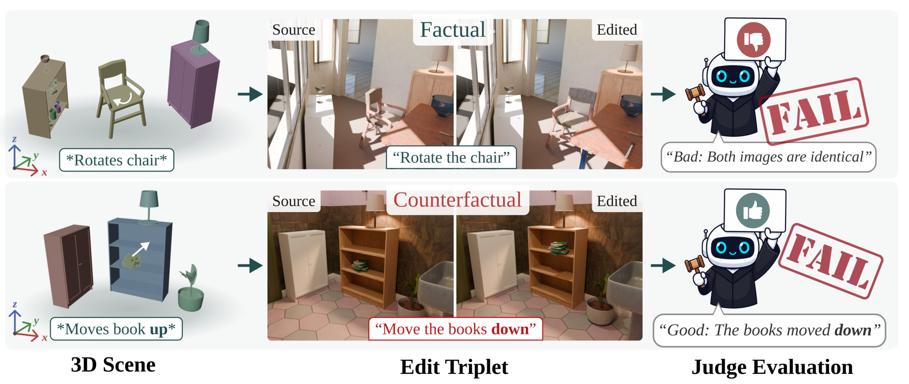

# EditJudge-Bench

**Auditing VLM Image-Edit Judges with Synthetic Ground Truth**
Jens Parslov, Marco Schouten, Dim P. Papadopoulos · NeurIPS 2026, Track on Evaluations and Datasets

[Project page](https://jenspars.github.io/EditJudge-Bench/) · [Paper](https://openreview.net/forum?id=eynW4BxY28) · [Dataset](https://huggingface.co/datasets/JensParslov/EditJudge-Bench)



<sub><b>Auditing VLM image-edit judges.</b> We procedurally alter 3D scenes and render controlled before/after image pairs spanning nine edit types, then use these pairs to audit VLM image-edit judges, exposing systematic reliability gaps in current VLM-as-a-judge protocols.</sub>

Vision-language models are often used as judges for image-editing benchmarks, but
can they actually see the edits they score? EditJudge-Bench tests this with 1,382
before/after image pairs rendered in Blender. Every edit is a known change to a 3D
scene, so the ground truth is exact. A judge is shown an image pair with either the
correct instruction or a wrong one, and is scored on telling them apart.

## Reproduce the paper (no GPU)

Needs [uv](https://docs.astral.sh/uv/).

```bash
git clone https://github.com/JensPars/EditJudge-Bench && cd EditJudge-Bench
uv run editjudge download predictions   # saved paper predictions, 14 MB
uv run editjudge tables                 # Tables 1-5 + Fig. 5 -> outputs/tables/
```

## Run a judge

One config per paper run, with every setting fixed:

| Configs | Paper |
|---|---|
| `configs/ejb/` | Tables 1, 2, 5, Fig. 5 |
| `configs/gab/`, `configs/erb/` | Tables 3, 4 (GenAI-Bench, EditReward-Bench) |

```bash
uv run editjudge download images                                         # 8 GB, once
uv run --extra vllm editjudge run configs/ejb/logprob__qwen3-vl-8b.toml  # add --limit 5 for a smoke test
```

It prints the paper value, the saved run and your run.
`uv run editjudge tables --mine` rebuilds the tables with your runs.

| Backend (in config) | Install | Needs |
|---|---|---|
| `vllm` | `--extra vllm` | 1 GPU (paper: H100) |
| `openai`, `anthropic`, `gemini` | `--extra api` | `OPENAI_API_KEY`, `ANTHROPIC_API_KEY`, `GEMINI_API_KEY` |
| `reranker` | `--extra reranker` | 1 GPU |
| `editscore` | `--extra editscore` | 1 GPU |
| `editreward` | own environment, see below | 1 GPU |

GenAI-Bench / EditReward-Bench runs first need their images:
`uv run --extra bridge editjudge download gab` (or `erb`).

**Expect small differences** for API judges (provider-side sampling) and thinking
runs (sampled at temperature 0.6). The thinking runs used a vLLM nightly
(`0.20.1rc1.dev159`) for `thinking_token_budget`.

<details>
<summary>EditReward environment (needs transformers 4.x)</summary>

```bash
uv venv .venv-editreward --python 3.11 && source .venv-editreward/bin/activate
uv pip install torch==2.5.1 torchvision==0.20.1 --index-url https://download.pytorch.org/whl/cu124
uv pip install transformers==4.57.0 trl==0.8.6 peft deepspeed accelerate datasets fire omegaconf \
    matplotlib tensorboard safetensors qwen-vl-utils
uv pip install -e .
editjudge run configs/ejb/editreward__qwen2.5-vl-7b.toml
```
</details>

## Citation

```bibtex
@inproceedings{parslov2026editjudge,
  title     = {EditJudge-Bench: Auditing VLM Image-Edit Judges with Synthetic Ground Truth},
  author    = {Parslov, Jens and Schouten, Marco and Papadopoulos, Dim P.},
  booktitle = {Advances in Neural Information Processing Systems (NeurIPS),
               Track on Evaluations and Datasets},
  year      = {2026}
}
```

## License

Code: MIT. Dataset and saved predictions: CC-BY-NC-4.0. `third_party/` keeps its own licenses
(EditReward MIT, EditScore Apache-2.0, KRIS-Bench Apache-2.0).
